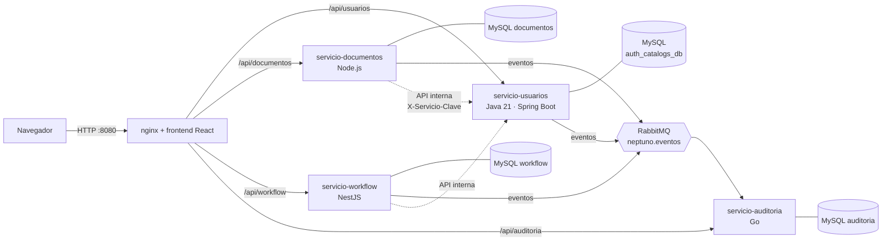

# Documentación · `servicio-usuarios` (ms-auth-catalogs) y base compartida

Guía para la presentación. Prioriza los **conceptos**: qué problema resuelve cada pieza, por qué se
decidió así y cómo se explica. El código se cita solo para ubicar dónde vive cada idea.

---

## 1. En una frase

`servicio-usuarios` es **la puerta de identidad de Neptuno**: sabe *quién eres* (autenticación),
*qué puedes hacer* (autorización por roles y permisos) y guarda los **catálogos maestros** que los
demás servicios usan (áreas, tipos documentales, entidades). Además registra cada acción relevante
en la bitácora enviando eventos a `servicio-auditoria`.

Cubre las HU-001…HU-016 y la HU-022 (17 historias, el 20 % del backlog de 85).

| Grupo | HU |
|---|---|
| Sesión | 001 iniciar sesión · 002 cerrar sesión |
| Usuarios | 003 crear · 004 editar · 005 baja lógica · 006 consultar y buscar · 012 asignar roles |
| Roles y permisos | 007 crear rol · 008 editar · 009 eliminar · 010 consultar · 011 asignar permisos · 013 restringir acceso por rol |
| Acceso entre servicios | 014 contexto de acceso para los documentos (API interna) |
| Catálogos | 015 tipos documentales · 016 áreas · 022 entidades |

---

## 2. Dónde encaja en la arquitectura



Ideas que sostienen el diagrama:

- **Un microservicio por dominio, cada uno con su propia base de datos.** Nadie lee tablas de otro
  servicio; si necesita un dato, lo pide por API. Eso evita acoplamiento y permite cambiar o escalar
  un servicio sin tocar los demás.
- **El navegador solo habla con nginx.** nginx reparte por prefijo de ruta (`/api/usuarios/`,
  `/api/documentos/`, …). Los puertos de los servicios no se exponen a internet.
- **Comunicación síncrona** (HTTP interno, con clave de servicio) cuando se necesita la respuesta
  ya; **asíncrona** (RabbitMQ) cuando solo hay que avisar algo, como la bitácora.

---

## 3. Conceptos clave (lo que hay que saber explicar)

### 3.1 Autenticación vs. autorización
- **Autenticación**: demostrar quién eres (correo + contraseña → HU-001).
- **Autorización**: qué puedes hacer una vez identificado (permisos → HU-013).
Son pasos distintos. Este servicio hace ambos para todo el sistema.

### 3.2 JWT (JSON Web Token)
Un JWT es un texto firmado que viaja en cada petición (`Authorization: Bearer …`) y dice quién eres
y qué puedes hacer. Va firmado, así que si alguien lo modifica la firma deja de coincidir.

Lo que lleva dentro (*claims*): `sub` (id del usuario), correo, nombre, área, roles, rol principal y,
en el token de acceso, la lista de **permisos**. Además `jti` (id único del token), `iat` (cuándo se
emitió) y `exp` (cuándo caduca).

- Firma: **HS256** (HMAC con un secreto compartido de mínimo 32 caracteres; el servicio no arranca si
  es más corto).
- **Sin estado (*stateless*)**: el servidor no guarda sesiones en memoria. Todo lo necesario viaja
  en el token. Por eso se puede reiniciar o escalar el servicio sin cerrar sesiones.

### 3.3 Dos tokens: acceso y refresco
| | Acceso | Refresco |
|---|---|---|
| Para qué | Autorizar cada petición | Pedir un acceso nuevo |
| Vigencia | **30 minutos** | **12 horas** |
| Lleva permisos | Sí | No, solo identifica al usuario |

Un acceso de corta vida limita el daño si se filtra. El refresco evita pedir la contraseña cada
30 minutos. En cada renovación el refresco se **rota**: el viejo se revoca y se entrega uno nuevo.

### 3.4 Revocación: por qué un JWT "sin estado" igual se puede invalidar
Un JWT válido sigue siéndolo hasta que caduca, aunque el usuario cierre sesión. Para resolverlo:
- Al cerrar sesión (HU-002) o rotar el refresco, el `jti` del token se guarda en la tabla
  **`token_revocado`**. Cada petición comprueba que su `jti` no esté ahí.
- Un trabajo programado **purga a las 03:00** los revocados que ya caducaron, para que la tabla no
  crezca sin límite (si ya caducó, igual no serviría).

### 3.5 Las cuatro validaciones de cada petición
Antes de dejar pasar un token de acceso, el decodificador verifica en cadena:
1. **Firma, emisor y expiración** (que sea auténtico y vigente).
2. **Tipo**: que sea de *acceso*; un refresco no sirve para llamar a la API.
3. **No revocado** (tabla `token_revocado`).
4. **Usuario activo y permisos al día** (`ValidadorUsuarioActivo`).

El punto 4 merece explicación: si dan de baja a un usuario (HU-005), **sus tokens dejan de servir de
inmediato**, aunque no hayan caducado. Y si le cambian los roles, o los permisos de uno de sus roles,
se actualiza `usuario.permisos_actualizados_en`; todo token emitido *antes* de ese instante se
rechaza (`permisos_desactualizados`). El frontend lo detecta (401), usa el refresco y recibe un
acceso con los permisos vigentes, sin que el usuario note nada.

> Matiz honesto para preguntas: los permisos viajan en el token, así que *autorizar* no requiere
> consultar la base de datos; pero el punto 4 sí lee al usuario en cada petición para saber si sigue
> activo. Es un compromiso: se paga una lectura simple a cambio de que una baja o un cambio de rol
> se aplique al instante.

### 3.6 Autorización por roles **y permisos** (RBAC)
- **Permiso**: una acción concreta, con formato `recurso:accion` (`usuarios:crear`,
  `radicados:consultar`, `flujos:administrar`, `bitacora:consultar`).
- **Rol**: un paquete de permisos (Administrador, Radicador…).
- **Usuario**: tiene uno o varios roles; sus permisos son la unión de los de sus roles.

Cada endpoint declara el permiso que exige (`@PreAuthorize`). Las pantallas se pintan o se ocultan
según los permisos de la sesión. **Se decide por permiso, no por nombre de rol**, así crear un rol
nuevo no obliga a tocar código.

Los permisos se agrupan por módulo: *Usuarios y roles*, *Catálogos maestros*, *Radicación*,
*Flujo de trabajo* y *Expediente y auditoría*. Regla de negocio ejemplo (HU-024): registrar un
documento de origen **Recibido** es exclusivo del rol Radicador, así que el Administrador recibe el
catálogo completo **menos** ese permiso.

### 3.7 Contraseñas y ataques contra el login
- **BCrypt**: la contraseña nunca se guarda; se guarda su hash con sal, lento a propósito.
- **Bloqueo temporal**: 5 intentos fallidos → cuenta bloqueada 15 minutos.
- **Mensaje genérico** ("El correo o la contraseña no son correctos"): no revela cuál de los dos falló.
- **Hash señuelo**: si el correo no existe, igual se compara contra un hash falso. Así responder
  "usuario inexistente" no es más rápido que "contraseña mala"; evita descubrir correos por tiempo
  de respuesta (*enumeración de cuentas*).
- El estado de la cuenta (inactiva) solo se revela a quien ya demostró conocer la contraseña.

### 3.8 Comunicación entre microservicios: la API interna
Los demás servicios necesitan datos de este (el rol y el área de un usuario, si tiene un permiso).
Lo hacen por `/api/usuarios/interno/**`, que **no usa el JWT del usuario** sino una cabecera
`X-Servicio-Clave` con una clave compartida entre servicios, comparada en tiempo constante
(`MessageDigest.isEqual`, para evitar ataques por tiempo). Ojo: nginx reenvía todo `/api/usuarios/`, así
que esa ruta es alcanzable desde fuera y la **única barrera es la clave** (sin ella, 401). Una mejora
posible es bloquear `/interno/` en nginx para que solo se llegue desde la red interna. Sirve a la HU-014: *"restringir el acceso a documentos
por rol"* (documentos pregunta aquí quién es el usuario para filtrar lo que ve).

### 3.9 Auditoría con **Transactional Outbox**
Cada acción relevante (login, crear usuario, cambiar rol…) debe quedar en la bitácora. El riesgo
clásico: guardar el cambio y que falle el aviso a RabbitMQ (o al revés). La solución:

1. Dentro de **la misma transacción** del cambio, se inserta el evento en la tabla
   `evento_auditoria` con estado `PENDIENTE`. Si la transacción se revierte, el evento desaparece.
2. Un proceso programado (cada **5 s**) toma los pendientes, los publica en RabbitMQ y los marca
   `PUBLICADO`. Si RabbitMQ está caído, simplemente reintenta en el siguiente ciclo.

Resultado: **nunca se anuncia un cambio que no ocurrió**, no se pierde ninguno, y la petición del
usuario no espera al broker (una caída de RabbitMQ no la vuelve lenta).

Detalles de RabbitMQ: un *exchange* directo `neptuno.eventos`, una cola durable `audit.infrastructure`
y una *routing key* `audit.evento` que las enlaza. Los eventos viajan como **JSON** porque
`servicio-auditoria` está escrito en Go y no podría leer un objeto serializado por la JVM: el formato
del evento es un **contrato entre servicios**.

### 3.10 Migraciones de base de datos (Flyway)
El esquema se crea y evoluciona con scripts SQL versionados (`V1…V6`) que Flyway aplica **una sola
vez** al arrancar, llevando el control en una tabla propia. La base vacía local y la del servidor
terminan idénticas, sin pegar SQL a mano. Hibernate está en modo `validate`: solo comprueba que el
esquema coincida con las entidades, nunca lo modifica. Es *idempotente*: reiniciar no repite nada.

Las migraciones no se editan una vez aplicadas; un cambio nuevo es un `V` nuevo (por ejemplo `V5` y
`V6` agregan los permisos de flujos).

### 3.11 Datos iniciales idempotentes (*seeding*)
Al primer arranque `DatosIniciales` siembra el catálogo de permisos, roles, áreas, tipos
documentales, entidades y el **administrador inicial** (su correo y clave vienen de variables de
entorno, no del código). Se ejecuta en cada arranque pero **no pisa** cambios hechos desde la
interfaz.

### 3.12 Baja lógica (*soft delete*)
Eliminar un usuario o un catálogo **no borra la fila**: lo marca inactivo y guarda quién y cuándo.
Así se conserva el historial y los documentos antiguos siguen apuntando a datos válidos. Reglas de
negocio asociadas:
- No puedes dar de baja tu propia cuenta.
- No se puede dar de baja (ni quitarle el rol) al **último administrador activo**.
- Un rol solo se elimina si no tiene usuarios; el rol de sistema Administrador no se elimina ni se renombra.
- Un área inactiva no puede asignarse a un usuario.

---

## 4. Flujos paso a paso (para explicar con el diagrama)

### 4.1 Iniciar sesión (HU-001)
1. El frontend envía correo y contraseña a `POST /api/usuarios/auth/login`.
2. El servicio busca el usuario (o usa el hash señuelo), revisa si está bloqueado, compara con BCrypt.
3. Si falla, cuenta el intento (al quinto, bloquea 15 min). Si acierta, reinicia el contador y anota
   el último acceso.
4. Comprueba que la cuenta esté activa.
5. Emite el token de acceso (con permisos) y el de refresco, y registra el evento `sesion.iniciada`.
6. El frontend guarda ambos y la sesión (nombre, área, rol, permisos) para pintar el menú.

### 4.2 Una petición autorizada
`Navegador → nginx → servicio` con `Authorization: Bearer <acceso>` → cadena de 4 validaciones (3.5)
→ `@PreAuthorize` mira si el permiso exigido está en el token → se ejecuta la lógica.
Si falta autenticación → **401**. Si está autenticado pero sin el permiso → **403**.

### 4.3 Renovación transparente (frontend)
Cuando una petición recibe 401, el cliente (`cliente.js`) intenta **una sola renovación** con el
refresco, aunque varias peticiones fallen a la vez (todas esperan la misma renovación). Si funciona,
reintenta la petición y recarga los permisos (por si cambiaron). Si no, emite el evento de sesión
perdida y la guarda de rutas lleva al login explicando por qué.

### 4.4 Cerrar sesión (HU-002)
Se revoca el token de acceso y el de refresco (su `jti` va a `token_revocado`) y se publica
`sesion.cerrada`. Aunque alguien copiara el token después, ya no sirve, lo que importa en equipos
compartidos. El frontend cierra la sesión local aunque el servidor no responda.

### 4.5 Cambiar los permisos de un rol (HU-011)
Se actualizan los permisos del rol y `permisos_actualizados_en` de los usuarios afectados → sus
tokens viejos se rechazan en la siguiente petición → el frontend renueva y recibe los nuevos.

---

## 5. Modelo de datos (`auth_catalogs_db`, 11 tablas)

| Tabla | Para qué |
|---|---|
| `usuario` | Cuenta: correo, hash de la clave, estado, intentos fallidos, bloqueo, último acceso, `permisos_actualizados_en`, datos de baja |
| `rol` · `permiso` | Roles y catálogo de permisos |
| `rol_permiso` · `usuario_rol` | Relaciones muchos-a-muchos (permisos de un rol, roles de un usuario) |
| `area` | Áreas organizacionales; cada usuario pertenece a una |
| `tipo_documental` · `tipo_documental_origen` | Tipos de documento y a qué orígenes aplican |
| `entidad` | Entidades externas |
| `token_revocado` | `jti` de tokens invalidados, con su expiración (para purgarlos) |
| `evento_auditoria` | La *outbox*: eventos pendientes o ya publicados |

Origen del documento (formato de radicado `AAAAMMDD + X + CONSECUTIVO`): **1** Interno, **2** Externo,
**3** Recibido, **4** No radicable. El catálogo se publica desde aquí en `GET /catalogos/origenes`.

---

## 6. Estructura del código

```
servicio-usuarios/src/main/java/co/gov/neptuno/usuarios/
├── auth/        Login, logout, refresco (HU-001, 002)
├── usuarios/    CRUD de usuarios, asignación de roles (HU-003…006, 012)
├── roles/       Roles y catálogo de permisos (HU-007…011)
├── catalogos/   Áreas, tipos documentales, entidades (HU-015, 016, 022)
├── seguridad/   Emisión de tokens, validadores, filtro de clave de servicio (HU-013)
├── interno/     API para otros microservicios (HU-014)
├── auditoria/   Outbox y publicación a RabbitMQ
├── config/      Seguridad, mensajería, datos iniciales, propiedades
└── comun/       Errores de API, enums, paginación
```
Patrón en cada módulo: **Controlador** (HTTP) → **Servicio** (reglas de negocio) → **Repositorio**
(acceso a datos) + **DTO** (lo que entra y sale de la API). Los errores de negocio son excepciones
tipadas (`Conflicto`, `ReglaInvalida`, `NoAutorizado`…) que un manejador central convierte en
respuestas HTTP consistentes.

---

## 7. Mi parte compartida: frontend base, compose y despliegue

### 7.1 Frontend (React)
- **SesionProvider**: guarda la sesión y los permisos y los ofrece a toda la app; es lo que decide qué
  menú y qué pantallas se muestran (HU-013 del lado cliente).
- **cliente.js**: único punto que habla con la API; añade el token, renueva en 401 (4.3).
- Pantallas mías: **Login, Panel, Usuarios, Roles y Configuración (catálogos)**. Los componentes
  comunes (`ui.jsx`, `Layout.jsx`, `Icons.jsx`, `styles.css`) los usan también las pantallas de los demás.
- Importante para explicar: **ocultar un botón no es seguridad**. La seguridad real está en el
  servidor (`@PreAuthorize`); el frontend solo mejora la experiencia.

### 7.2 nginx
Sirve el frontend y hace de **proxy inverso**: cada prefijo `/api/<servicio>/` se reenvía al servicio
correspondiente por la red interna. Añade cabeceras de seguridad y sobrescribe `X-Forwarded-For`
con la IP real del cliente, para que no se pueda falsificar.

### 7.3 `docker-compose.yml`
Define el stack completo: frontend, 4 servicios, 4 bases MySQL (una por servicio), RabbitMQ y los
volúmenes que conservan los datos. Conceptos útiles:
- **Variables obligatorias** (`${JWT_SECRETO:?…}`): el stack no arranca si falta un secreto, en vez de
  arrancar inseguro.
- **Healthchecks** y `depends_on`: la base y RabbitMQ deben estar sanos antes que el servicio.
- **`mem_limit`**: tope de memoria por contenedor, porque la JVM se dimensiona según la RAM que ve.
- Los puertos de los servicios se enlazan a `127.0.0.1`; solo el frontend (`:8080`) es público.

### 7.4 Despliegue en AWS
Todo corre en **una instancia EC2** (servidor virtual de AWS, Ubuntu 24.04) con **Podman**, no
Docker: no necesita un demonio con privilegios de root y corre sin privilegios (*rootless*) bajo el
usuario `ubuntu`. Los `Dockerfile` y el compose son estándar, Podman los lee igual.
- `desplegar-ec2.sh`: instala Podman, genera `.env` con **secretos aleatorios** la primera vez,
  reconstruye y levanta el stack; es **idempotente** (se puede repetir tras un `git pull`) y deja una
  unidad de systemd para que el stack vuelva solo si se reinicia la máquina.
- `controlar-ec2.sh`: encender, apagar y consultar el estado (apagada no consume horas de cómputo).
- Los secretos nunca están en el repositorio: viven en `.env` del servidor.

---

## 8. Pruebas

**38 pruebas de integración** (JUnit, contra una base real, no simulada), organizadas por tema:
autenticación (7), usuarios (8), roles (7), catálogos (5), API interna (5), seguridad de sesión (3),
catálogo de permisos (2) y último administrador (1). Cada HU del servicio tiene al menos una prueba
que la verifica; el mapa HU ↔ endpoint ↔ permiso ↔ prueba está en `docs/MATRIZ-API-HU.md`.

---

## 9. Decisiones de diseño y por qué

| Decisión | Razón | Costo / alternativa |
|---|---|---|
| JWT sin estado | Escala y reinicia sin perder sesiones | Hubo que construir revocación (tabla `token_revocado`) |
| Acceso corto + refresco rotativo | Limita el daño de un robo y evita pedir la clave a cada rato | Más piezas que una sesión simple |
| Permisos en el token | Autorizar sin consultar la base | Se rechazan tokens viejos al cambiar permisos (`permisos_actualizados_en`) |
| HS256 (secreto simétrico) | Simple: un solo servicio firma y valida | Quien conozca el secreto puede firmar; con varios servicios validando conviene RS256 (clave pública/privada) |
| Outbox + RabbitMQ | Bitácora fiable sin acoplar al broker | Latencia de hasta ~5 s en llegar a la bitácora |
| Base por servicio | Independencia entre dominios | No hay *joins* entre servicios; se piden por API |
| Flyway | Esquema versionado y reproducible | No se editan migraciones ya aplicadas |
| Baja lógica | Conserva historial y trazabilidad | Hay que filtrar los inactivos |
| Podman | Sin demonio root, rootless | `podman-compose` 1.0 ignora algunos `condition: service_healthy`; los servicios reintentan |

---

## 10. Preguntas probables y respuestas cortas

**¿Por qué JWT y no sesiones del servidor?** Sin estado: cualquier instancia valida el token sin
compartir memoria. A cambio hay que resolver la revocación, y se hizo con una tabla.

**¿Qué pasa si roban un token de acceso?** Dura 30 minutos como máximo, y se revoca al cerrar
sesión; si dan de baja al usuario deja de servir al instante.

**¿Y el refresco?** Es de un solo uso: al renovar se revoca y sale uno nuevo, así que uno robado y
ya usado no sirve.

**¿Qué diferencia hay entre 401 y 403?** 401: no estás autenticado o el token no vale. 403: estás
autenticado pero no tienes el permiso.

**¿Por qué permisos y no solo roles?** Un rol es un paquete cambiable; el código pregunta por
acciones concretas. Crear o modificar roles no requiere tocar código.

**¿Cómo se protege la contraseña?** Solo se guarda su hash BCrypt con sal; hay bloqueo tras 5
fallos y respuestas que no revelan si el correo existe.

**¿Cómo sabe documentos quién es el usuario?** Llama a la API interna de usuarios con la clave de
servicio; no reutiliza el token del usuario.

**¿Qué pasa si RabbitMQ se cae?** Los eventos se quedan `PENDIENTE` en la base y se envían cuando
vuelva. La operación del usuario no se ve afectada.

**¿Por qué una base de datos por servicio?** Para que cada equipo evolucione su esquema sin romper a
los otros; se paga con comunicación por API.

**¿Por qué Podman en vez de Docker?** No necesita un demonio con root y corre rootless; usa los
mismos `Dockerfile` y `docker-compose.yml`.

**¿Cómo se actualiza la base en el servidor?** Con migraciones: al arrancar, cada servicio aplica
solo las que le faltan, una vez cada una. Basta con `git pull` y `./desplegar-ec2.sh`.

**¿Qué falta?** El 47 % del backlog: flujo de trabajo (bandeja, firma, versionado), anexos y
plantillas en documentos, y lo no funcional de auditoría (copias, métricas, pruebas de carga).

---

## 11. Glosario rápido

| Término | Significado |
|---|---|
| **JWT** | Token firmado que lleva la identidad y los permisos |
| **Claim** | Un dato dentro del JWT (`sub`, `exp`, `roles`…) |
| **Stateless** | El servidor no guarda sesión; todo viaja en el token |
| **RBAC** | Control de acceso basado en roles (aquí con permisos granulares) |
| **BCrypt** | Algoritmo de hash lento con sal para contraseñas |
| **Outbox** | Guardar el evento en la misma transacción y publicarlo después |
| **Exchange / cola** | En RabbitMQ: el punto de entrada y el buzón que guarda los mensajes |
| **Flyway** | Herramienta de migraciones versionadas de base de datos |
| **Idempotente** | Se puede repetir sin cambiar el resultado |
| **Soft delete** | Marcar como inactivo en vez de borrar |
| **Proxy inverso** | nginx recibe la petición y la reenvía al servicio correcto |
| **EC2** | Servidor virtual de AWS |
| **Podman** | Motor de contenedores sin demonio root, compatible con Docker |

---

## 12. Guion de 5 minutos

1. **Qué es** (30 s): puerta de identidad + catálogos + origen de la bitácora.
2. **Arquitectura** (45 s): diagrama de la sección 2; una base por servicio; nginx; RabbitMQ.
3. **Sesión con JWT** (90 s): login → dos tokens → 4 validaciones → revocación → renovación transparente.
4. **Roles y permisos** (45 s): permiso = acción, rol = paquete, decisión en el servidor.
5. **Bitácora fiable** (45 s): outbox + RabbitMQ + JSON como contrato.
6. **Despliegue** (45 s): compose, Podman en EC2, migraciones y secretos.
7. **Cierre** (20 s): 17 HU, 38 pruebas, y qué viene después.

---

## 13. Tu exposición: láminas 10 a 17 (5 min)

Según `GUION-EXPOSICION-1.pdf` hablas **segundo**, después de Kevin (láminas 6 a 9) y antes de Juan
(lámina 18). Tu entrada y tu salida son fijas:

- **Recibes** de Kevin, quien termina diciendo «Alvaro les cuenta cómo se controla el acceso y quién
  puede hacer qué».
- **Entregas** a Juan con la frase «Juan les cuenta cómo queda registrado todo lo que ocurre».

| Lámina | Qué muestra | Dónde está explicado en este documento |
|---|---|---|
| 10 y 11 · Historias (HU-001…016, 022) | Las 17 historias en dos láminas | Sección 1 |
| 12 · Cómo está armado | Controlador → Servicio → Repositorio → MySQL (Flyway); `PublicadorEventos`; `ControladorInterno` | Secciones 3.9, 3.10 y 6 |
| 13 · Sesión y autorización | Login → tokens de 30 min y 12 h → cadena de validadores → `@PreAuthorize` | Secciones 3.2 a 3.6 y 4.1 a 4.2 |
| 14 · Demo: acceso y panel | Login y panel; el menú cambia según el rol | Sección 7.1 |
| 15 · Demo: usuarios | Buscar por nombre, rol y estado; baja lógica | Sección 3.12 |
| 16 · Demo: roles y permisos | Permisos agrupados por módulo; efecto inmediato al cambiarlos | Secciones 3.6 y 4.5 |
| 17 · Demo: parámetros | Tipos documentales, áreas y entidades (desactivar, no borrar) | Sección 3.12 |

**Una precisión para no contradecirte con la lámina 13.** La lámina muestra tres validadores
(*tipo de token*, *revocación* y *usuario activo*). En este documento hablo de cuatro porque cuento
también la **verificación de firma y expiración**, que el decodificador hace antes de esos tres. Si
te preguntan: "primero se comprueba la firma y que no haya expirado, y luego pasa por la cadena de
tres validadores".

**Preguntas que el guion ya anticipa para ti** (respuestas en la sección 10):
1. ¿Por qué el token lleva los permisos si pueden cambiar? → se revalida en cada solicitud (3.5).
2. ¿Qué pasa con un usuario dado de baja que aún tiene sesión? → su token deja de servir en la
   siguiente solicitud (3.5).
3. ¿Cómo se entera documentos del área del usuario? → API interna de contexto de acceso con clave de
   servicio (3.8).

**Cosas de otras láminas que podrían preguntarte a ti**, porque salieron de tu parte compartida:
Podman Compose con 10 contenedores, secretos en `.env`, el despliegue en EC2 y la mensajería con
reintento (lámina 4, que presenta Kevin). Respuestas en las secciones 3.9, 7.3 y 7.4.

**Tener a mano** (lista del guion): `docs/MATRIZ-API-HU.md`, las 38 pruebas (`mvn test`), Swagger en
`/api/usuarios/documentacion`, `ValidadorUsuarioActivo.java` y `CatalogoPermisos.java`.
